# eeg_c1_moe

Collected from `/leonardo_scratch/fast/IscrB_WearUsFM/yanlchen/runs/pretrain_eeg_c1_moe` by `scripts/collect_pretrain_run.sh`.

60 epoch(s) with validation; last epoch 59, step 46080.

| selection | epoch | val total | val spec | val raw | spec r | raw r |
|---|---|---|---|---|---|---|
| best total (best.pth) | 57 | 0.24879 | 0.30462 | 0.19296 | 0.831 | 0.847 |
| best spec | 58 | 0.24880 | 0.30461 | 0.19300 | 0.831 | 0.847 |
| best raw | 56 | 0.24885 | 0.30474 | 0.19295 | 0.831 | 0.847 |
| last | 59 | 0.24881 | 0.30464 | 0.19297 | 0.831 | 0.847 |

Per route and per dataset: `progress_by_route.txt`, `progress_by_dataset.txt`. What each figure was drawn from: `figure_metadata/`.

## 10_dual_objective

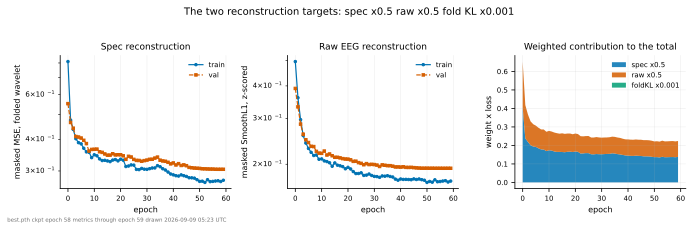

## 11_masked_vs_visible_error

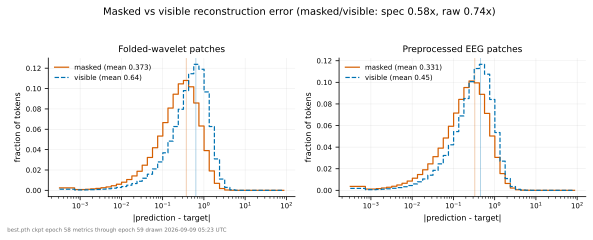

## 12_gradient_flow

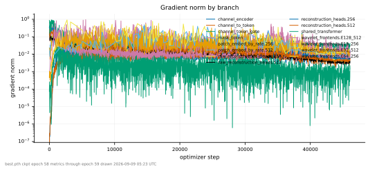

## 13_route_cost

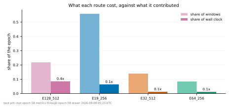

## 14_raw_waveform_reconstruction

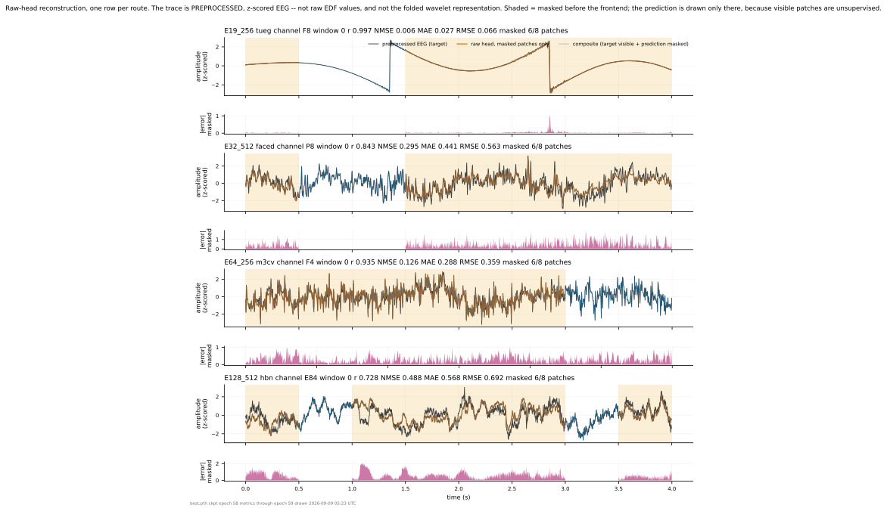

## fig_channel_embedding

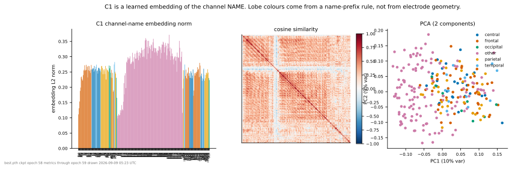

## fig_dataset_routes

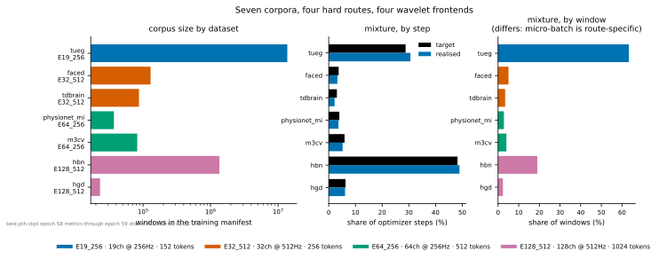

## fig_mask_examples_by_dataset

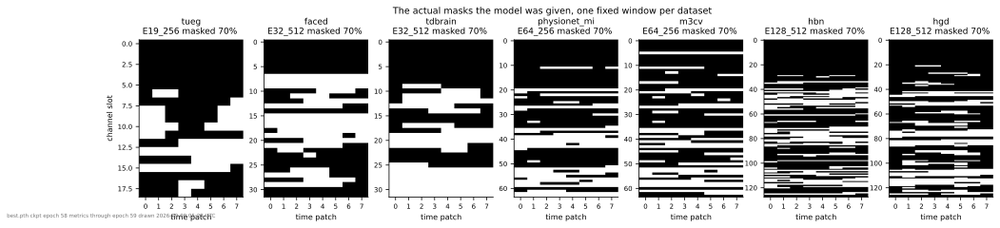

## fig_mask_reconstruction

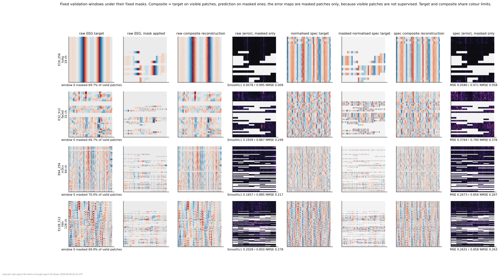

## fig_mask_statistics

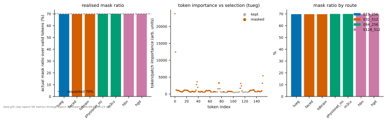

## fig_paper_channel_topology ([PDF](figures/fig_paper_channel_topology.pdf))

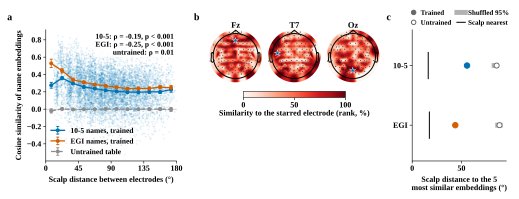

## fig_paper_mask_reconstruction ([PDF](figures/fig_paper_mask_reconstruction.pdf))

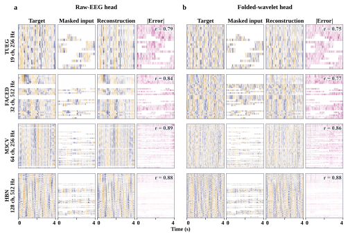

## fig_paper_raw_waveform ([PDF](figures/fig_paper_raw_waveform.pdf))

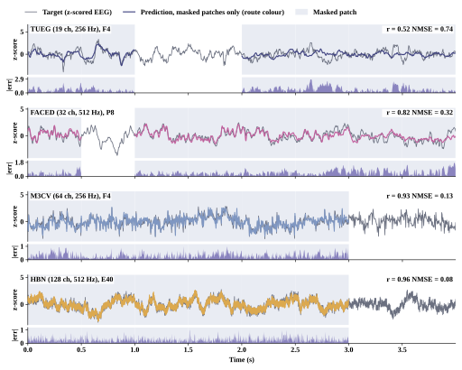

## fig_pretraining_convergence

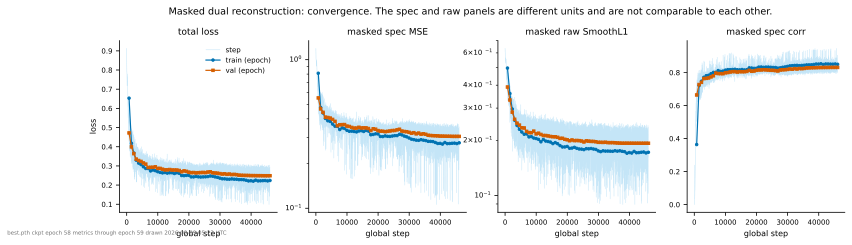

## fig_route_convergence

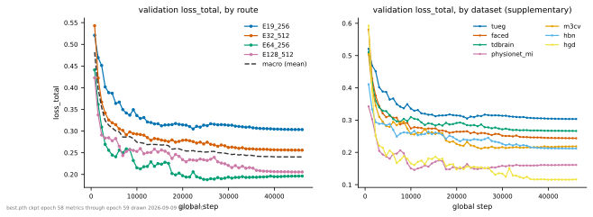

## fig_scale_fold_weights

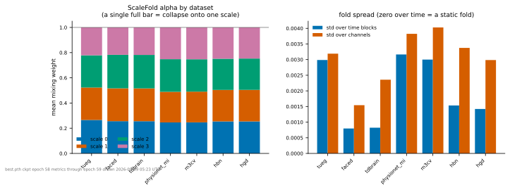

## fig_wavelet_frequency_response

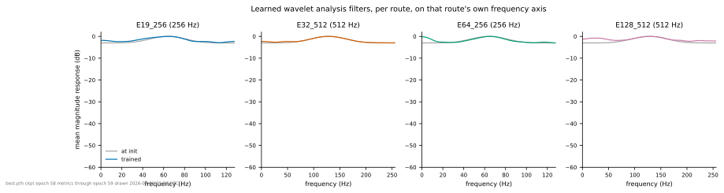
