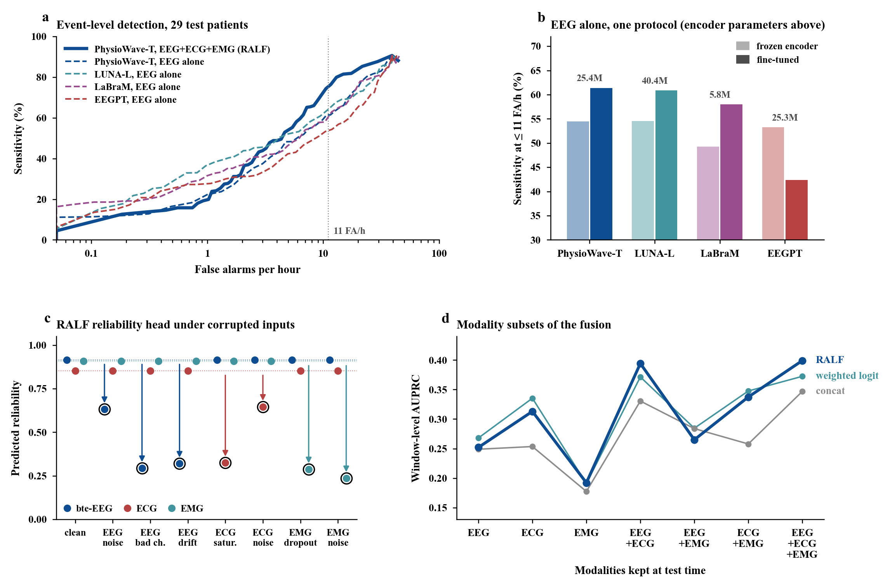

# SeizeIT2 multimodal figures: ralf_frozen_szo

Drawn by `scripts/visualize_seizeit2.py` at commit `4d48452b64bb1676a93fe15fe879d3ff58bd012c` from the synced results of `ralf_frozen_szo` (branch `cineca-results`, snapshot 2026-10-21 05:22) and of `weighted_logit_frozen_szo`, `concat_frozen_szo` and the eight EEG-alone runs. Vector figures with editable text; the arrays behind each are in `figure_data/` (not committed), what produced each in `figure_metadata/`.

## fig_main

SeizeIT2, official split, 29 test patients (2,912 h, 181 seizures). (a), (b): the dataset paper's event scoring (any-overlap, recording means), the 11 FA/h line is the SVM's operating point; each EEG-alone encoder in (a) at its better of frozen / fine-tuned; (d): the window-level test set, the metric the runs are selected on; (c) corruption severity 0.7

